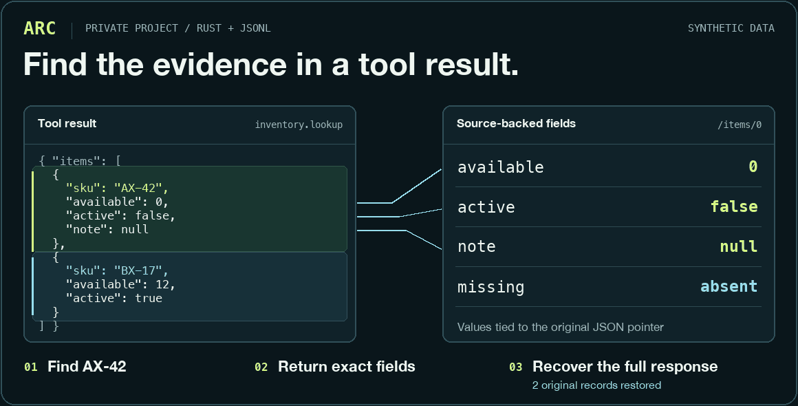

# Alexander Habscheid

I build tools that help AI agents call services, work through tool results, and recover when things fail. I’m open to software engineering internships in backend, infrastructure, and developer tooling.

## Projects

### [Orbit](https://github.com/AlexanderHabscheid/Orbit) · Local-first messaging

A NATS-backed message bus with request/reply, pub/sub, and traces for retries and timeouts.

[Watch the 45-second walkthrough](https://github.com/AlexanderHabscheid/Orbit#45-second-walkthrough) · [Run the quickstart](https://github.com/AlexanderHabscheid/Orbit#60-second-quickstart)

### ARC · Source-backed tool results

ARC is a private Rust project. This preview shows its JSONL runtime finding a record in synthetic data, returning exact fields with a source reference, and recovering the original response.

<picture>
  <source media="(prefers-reduced-motion: reduce)" srcset="assets/arc-teaser-still.png">
  
</picture>

### [Velocity](https://github.com/AlexanderHabscheid/velocity) · WebSocket proxy

Adaptive batching with a p95 latency budget, an HTTP control plane, and TypeScript and Python SDKs.

[Quickstart](https://github.com/AlexanderHabscheid/velocity/blob/main/docs/first-15-minutes.md) · [Benchmark](https://github.com/AlexanderHabscheid/velocity#ci-gate)
